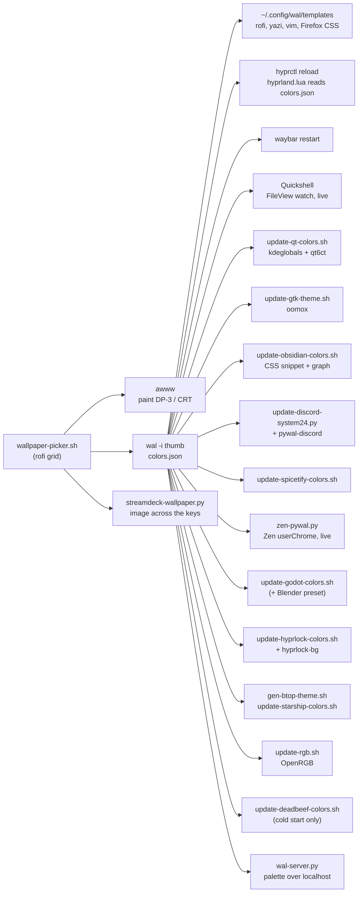

# dotfiles

An Arch (CachyOS) + Hyprland desktop that runs as one system: pick a wallpaper and around twenty apps retheme to match, a Quickshell widget layer handles media, calendar, network and notifications, and a 5:4 CRT sits next to the main monitor as a retro-gaming screen.

**Status:** this is the author's daily desktop, published as it runs, with personal paths, accounts and device names moved into variables or config files. It is not an installer. Expect to change output names (`DP-3`, `HDMI-A-1`), device names and a few paths for your own machine. There is also a laptop variant of the wallpaper picker.

<!-- MEDIA: hero screenshot of the full desktop. Both screens if possible (DP-3 at 2560x1440 with waybar + a couple of tiled windows, and the CRT showing its own bar). Use `grim` on the whole layout, or two shots side by side. -->

## What it does

- **One wallpaper themes everything.** `SUPER+Home` opens a rofi thumbnail grid. Pick an image and a screen (main, CRT, both, colours only, or the Stream Deck), and pywal's palette is pushed into Hyprland borders, waybar, rofi, kitty, Neovim, yazi, btop, Starship, GTK, Qt/KDE, Obsidian, Discord, Spotify, Zen/Firefox, Godot, Blender, DeaDBeeF, hyprlock, the motherboard/RAM/AIO RGB, and a Stream Deck that shows the wallpaper across its keys.
- **Hyprland in Lua.** Uses the Lua config format: two monitors, a 10-workspace pool for each screen (`SUPER+1..0` for the main monitor, `SUPER+ALT+1..0` and the numpad for the CRT), per-app workspace and monitor rules, and games pinned to the right screen when their window opens.
- **Quickshell widgets** (about 10k lines of QML): a vinyl-style media popup, a music player with a 10-band EQ, a calendar with weather where clicking any day opens that day's Obsidian daily note, a focus-time tracker that logs active-window time to SQLite, a control center (notifications, sliders, power profiles, lock/suspend/reboot), a Wi-Fi/Ethernet/Bluetooth manager, notification toasts, and a volume OSD.
- **Waybar** on both screens, with click-throughs into the widgets and album art.
- **Desktop helpers:** a keybind viewer and conflict checker, and a trackball mode switcher.
- **CRT gaming:** a rofi launcher for Brutal Doom (solo or co-op), a daemon that switches the CRT to 59.94 Hz while a Dolphin game is on it, a GameCube-adapter polling-rate probe, and lock/idle scripts that sleep the CRT without touching the main monitor.
- **Related repos:** binaural 7.1 audio is [pipewire-surround](https://github.com/CipherNovaa/pipewire-surround), the typing dashboard is [keybr-ws](https://github.com/CipherNovaa/keybr-ws), and the window-rule manager is [hyprule](https://github.com/CipherNovaa/hyprule).

<!-- MEDIA: GIF (10-15 s) of the wallpaper picker: open it with SUPER+Home, pick an image, and show waybar, a kitty window, rofi and Obsidian changing colour together. -->

## How it works

### The pywal fan-out

`pywal/wallpaper-picker.sh` is the hub. It paints the image with `awww`, runs `wal` on a thumbnail, then calls one small adapter per app. Each adapter reads `~/.cache/wal/colors.json` and writes that app's own format.



Some of the harder parts:

- **Zen Browser ignores pywalfox.** Zen's chrome doesn't use Firefox's `theme` API, so pywalfox had no visible effect. `zen-pywal.py` writes a stylesheet that overrides Zen's own CSS variables (`--zen-primary-color` and friends), using the most saturated palette colour as the accent. `userChrome.css` is only read at startup, so `zen-pywal-autoconfig.js` runs privileged at launch, polls the file, and re-registers it as a user sheet when it changes. Re-registering the `file://` URI is served from cache and doesn't repaint, so the CSS is inlined as a `data:` URI. Zen can also leave a full-looking stale profile in an old root, so the script picks the profile whose `places.sqlite` was touched most recently.
- **`hyprctl keyword` no longer works on the Lua build**, which quietly killed the old border-colour step. `hyprland.lua` now reads `colors.json` itself when it loads, so every `hyprctl reload` reapplies the current gradient.
- **The Obsidian graph is drawn on a canvas and only reads `graph.json` at startup.** The script recolours two graph groups with the wallpaper's two most-contrasting colours, falls back to neutral greys on black-and-white wallpapers, and when the colours actually changed it sends Obsidian's reload shortcut through the Hyprland socket. It then watches for about 1.8 s and hands focus back if Obsidian grabs it.
- **Stream Deck as a desk piece.** `streamdeck-wallpaper.py` cuts the chosen image into one tile per key, leaving a gap for the bezels between keys so the picture lines up across them. GIF, WebM and MP4 loop as animation (video frames piped through ffmpeg into PIL). Starting a new copy replaces the running one, using a lockfile plus SIGTERM to the old process.
- **Blender** gets an interface-theme preset generated from the palette by a separate third-party script (`blenderwal.py`, not included here since its origin and licence couldn't be confirmed). The picker skips it if it's missing.
- **Apps that can theme themselves live are left alone while running.** Godot (an editor addon) and DeaDBeeF (a plugin) re-theme live, so their adapters only write config when the app is closed. Otherwise the app would overwrite the file on exit.

### Quickshell

One fullscreen layer-shell window (`Main.qml`) switches between widgets in a `StackView`. `WindowRegistry.js` maps each widget name to a size, position and QML file. Everything is driven over IPC: `qs ipc call main handleCommand toggle <widget> ''`, which waybar clicks and Hyprland binds both call. `MatugenColors.qml` keeps the upstream filename so the ported widgets didn't need edits, but now watches pywal's `colors.json` for changes instead of polling a temp file every second. Quickshell is also the notification daemon (it replaced dunst).

Bugs that took real digging:

- **The music widget showed one player's title next to another player's artwork.** The info script made about 14 separate `playerctl` calls, and each one picked a player on its own, in bus order rather than by which one was playing. It now picks one player (a playing one wins, and the choice sticks so two players can't flip-flop) and reads every field in a single `playerctl -p` call.
- **The control center's notification history was always empty.** The dispatcher only hands a notification model to widgets that declare the property, and `undefined` counts as not declared. The fix was a default of `null`.

<!-- MEDIA: screenshot grid of the widgets: music player with the EQ open, calendar (month view with weather), control center, network manager. -->

### Desktop helpers

- `scripts/keybinds/keybind_manager.py` merges `hyprctl binds -j` (the active binds, used for conflict detection) with a bracket-balanced parse of `hyprland.lua` (readable labels, since the Lua dispatcher just reports `__lua`). It has `--rofi` (Enter opens the bind's line in Neovim), `--conflicts`, `--list` and `--json` modes.
- `scripts/system/trackball-mode.py`: on the Kensington TB550, holding the wheel button and rolling the ball scrolls. libinput then owns that button: a hold turns into scrolling, and a quick click only arrives on release. So Aseprite's middle-drag pan zoomed instead, and Valheim never saw the middle button. The script follows the focused window over Hyprland's event socket and switches the device to `no_scroll` while Aseprite, Blender, Godot or a game is focused, and back to hold-to-scroll everywhere else. `hyprctl keyword` doesn't work on the Lua build, so it sends the whole device block through `hyprctl eval 'hl.device({...})'` (the same Lua API [hyprule](https://github.com/CipherNovaa/hyprule) uses) and reapplies it whenever the config reloads.
- **Godot dev setup:** `SUPER+G` opens a Godot workspace with Kitty + Neovim (LazyVim, GDScript LSP) beside the Godot editor, which uses Neovim as its external editor. A small `@tool` editor addon re-themes Godot live from `colors.json`, and `update-godot-colors.sh` handles the case where Godot is closed. The launcher and addon aren't in this repo yet.

### CRT gaming

The CRT is an NEC XV17+, natively 5:4 at 1280x1024@75. Games are kept at that mode so the picture fills the tube instead of letterboxing.

- `gaming/brutal-doom.sh`: a rofi menu for solo Doom II or Ultimate Doom on GZDoom (`+vid_aspect 5`), browsing servers in Doomseeker, hosting a private Zandronum co-op server (it shows your public address and the UDP port), or joining by IP. Window rules in `hyprland.lua` send the game to the CRT workspace fullscreen. Bring your own pk3 and IWADs; none are included.
- `gaming/dolphin-crt60d.py`: GameCube games run at 59.94 fps. On a 75 Hz CRT, every fourth frame is held for two refreshes, a steady judder. This user service watches Hyprland's socket, switches the CRT to 640x480@59.94 while a Dolphin game window is on it, and restores the mode from `hyprland.lua` afterwards. It only restores a mode it set itself.
- `gaming/gc_adapter_check.py`: talks to a GameCube adapter (Wii U mode) through libusb via `ctypes` and prints each port's status and the measured polling rate.
- Small launchers: Flycast at 4:3, The Typing of the Dead through gamescope, and an NEC test-pattern tool.

#### Sleeping only the CRT

The main monitor and the CRT share the GPU's two display controllers (CRTCs). Any *compositor-side* DPMS or disable of the CRT makes Hyprland's DRM backend tear down **both** outputs to reshuffle them, which blanks the main monitor for a moment and kills whatever terminal is in front. `hyprland.log` showed the safe path: if the kernel reports the CRT's connector as **disconnected**, the backend handles only that output and logs that it is skipping DP-3. So `scripts/system/root/crt-power` writes `off` / `detect` to `/sys/class/drm/card*-HDMI-A-1/status`, and the lock script, hypridle and the idle scripts all go through it, or `dp-power` for the main monitor, using a narrow sudoers rule. No DPMS anywhere.

The whole chain: `lock-crt-sleep.sh` (on `Pause` and as hypridle's `lock_cmd`) notes which screens are lit, sleeps the CRT, runs hyprlock, and restores exactly what was lit afterwards. `idle-dp-off.sh` / `idle-dp-on.sh` darken the main monitor after 30 minutes, but only while locked. `idle-crt-on.sh` relights the tube after a suspend only if the session is unlocked. `lock-anchor.sh` is the next step and isn't wired in yet: with both screens disconnected Hyprland has zero outputs and can crash when a window maps, so it creates a headless stand-in output before the last real screen goes dark.

The larger CRT projects have their own repos: [mgs4-crt](https://github.com/CipherNovaa/mgs4-crt) and [ac6-crt-5to4](https://github.com/CipherNovaa/ac6-crt-5to4). Per-window rules for moving games to the CRT are managed by [hyprule](https://github.com/CipherNovaa/hyprule).

<!-- MEDIA: photo of the CRT running Brutal Doom (or Melee) next to the main monitor, plus a screenshot of the Brutal Doom rofi menu. -->

## Workflow for this project

Most of this system was built and debugged in sessions with cloud LLM coding agents. Specifically:

- **The CRT sleep bug.** Sleeping the CRT kept crashing the agent's own terminal session. The agent stopped guessing at DPMS syntax and read `hyprland.log`. It found two distinct backend paths (DPMS drops both CRTCs, a connector disconnect drops only one) and moved everything to the sysfs connector path. Experiments with the screens use a self-reverting test (a detached watchdog restores the screen after 8 s) so a bad attempt can't leave the session dark.
- **Feedback the agent can read.** `keybind_manager.py --conflicts` gives a pass/fail check, so every keybind change ends with the agent proving there are no collisions. For theming, the agent pushes an unmistakable test colour (opaque magenta) and checks a `grim` screenshot. Zen's translucent chrome made subtle colours give false positives.
- **Handoffs between models.** The `dp-power` approach to sleeping the main monitor came from a separate analysis subagent. The main agent turned it into the root helper, the sudoers rule and the hypridle wiring.

## Requirements

Arch / CachyOS. Not every piece is needed; each folder works mostly on its own.

- **Core:** Hyprland built with the Lua config (0.55.x here), hypridle, hyprlock, waybar, rofi (Wayland), Quickshell 0.3, kitty, `python-pywal`, `awww`, ffmpeg, jq, playerctl, PipeWire + pipewire-pulse + WirePlumber, wl-clipboard, cliphist, grim, slurp, satty, inotify-tools, curl, Iosevka Nerd Font
- **Widgets:** NetworkManager (`nmcli`), bluez (`bluetoothctl`), power-profiles-daemon, brightnessctl (laptop), python3 with sqlite3, an OpenWeather API key (free)
- **Fan-out targets (optional, each one skips itself if the app is missing):** qt6ct, [oomox-gtk-theme](https://github.com/themix-project/oomox-gtk-theme) cloned to `~/oomox-gtk-theme`, pywalfox, pywal-discord, Vesktop + system24, spicetify, Starship, btop, OpenRGB, Obsidian, Godot 4.6, Blender, DeaDBeeF, python-elgato-streamdeck + Pillow in a venv
- **CRT gaming:** gzdoom, zandronum, doomseeker, wlr-randr, gamescope, wine, ydotool, libusb, Dolphin

## Install

Clone it somewhere (for example `~/dotfiles`) and symlink the pieces you want. The configs expect scripts under `~/scripts/...`, so the links recreate that layout:

```bash
D=~/dotfiles
# configs
ln -s $D/hypr       ~/.config/hypr
ln -s $D/waybar     ~/.config/waybar
ln -s $D/quickshell ~/.config/quickshell
mkdir -p ~/.config/rofi ~/.config/wal && ln -s $D/rofi/config.rasi ~/.config/rofi/config.rasi
ln -s $D/pywal/templates ~/.config/wal/templates
# scripts
mkdir -p ~/scripts/{system,bar,keybinds,media,gaming}
ln -s $D/pywal/*.sh $D/pywal/zen-pywal* $D/pywal/update-discord-system24.py $D/pywal/streamdeck-wallpaper.py ~/scripts/system/
install -m755 $D/pywal/wal-server.py ~/.local/bin/wal-server
ln -s $D/scripts/system/*.sh $D/scripts/system/*.py ~/scripts/system/
for d in bar keybinds media; do ln -s $D/scripts/$d/* ~/scripts/$d/; done
ln -s $D/gaming/brutal-doom.sh ~/scripts/gaming/
ln -s $D/gaming/dolphin-crt60d.py $D/gaming/crt60-test.sh ~/scripts/system/
ln -s $D/gaming/gc_adapter_check.py $D/gaming/{flycast,nec,ttotd}-launch.sh ~/scripts/
# user services (pick the ones you use)
mkdir -p ~/.config/systemd/user
cp $D/quickshell/systemd/*.service $D/gaming/systemd/*.service ~/.config/systemd/user/
```

Then:

1. **Screen power helpers** (root, optional): `sudo install -m755 scripts/system/root/{crt-power,dp-power} /usr/local/bin/` and add `scripts/system/root/sudoers.example` with `sudo visudo -f /etc/sudoers.d/crt-power`.
2. **Waybar media module:** clone [GabriWar/waybar-mediaplayer](https://github.com/GabriWar/waybar-mediaplayer) (MIT) into `~/.config/waybar/waybar-mediaplayer`, check out the base commit named in `waybar/waybar-mediaplayer.local.patch`, and `git apply` the patch.
3. **Weather:** copy `hypr/scripts/quickshell/calendar/.env.example` to `.env` in the same folder and fill in your OpenWeather key and city id.
4. **Obsidian:** set `OBSIDIAN_VAULT` (and optionally `OBSIDIAN_JOURNAL_DIR`, `OBSIDIAN_DAILY_TEMPLATE`, `OBSIDIAN_GRAPH_A/B`) in your session environment or in `quickshell.service`.
5. **Music EQ:** the music widget's EQ sliders drive the filter chain from [pipewire-surround](https://github.com/CipherNovaa/pipewire-surround). Without it they save their state but change nothing.
6. **Wallpapers:** none are included. Put your own in `~/Pictures/Wallpapers` (or set `WALLPAPER_DIR`).
7. **Network widget sounds:** optional. Copy the five `.wav` cues from the upstream repo's `assets/sounds/network/` into `quickshell/network/sounds/`. Without them the widget is just silent.

Rename `DP-3` / `HDMI-A-1` in `hyprland.lua`, `waybar/config.jsonc` and the CRT scripts to match `hyprctl monitors`.

## Usage

| Key | Action |
|---|---|
| `SUPER+Home` | wallpaper picker (rethemes everything) |
| `SUPER+F9` / `F10` / `F11` / `F12` | network / calendar / focus time / music widgets |
| clock left / right click | calendar / control center |
| `SUPER+I` | keybind viewer (`keybind_manager.py --rofi`) |
| `SUPER+ALT+1..0`, `SUPER+ALT+numpad` | CRT workspaces 11-20 |
| `Print` / `SUPER+Print` | region screenshot to clipboard / annotate in satty (grim + slurp) |
| `Pause` | lock, and put the CRT to sleep |
| `SUPER+F8` | game mode toggle |

## Credits

- **Quickshell core:** the dispatcher (`Main.qml`, `WindowRegistry.js`, `Caching.qml`, `Scaler.qml`), the music, calendar, focus-time, control-center, network and notification widgets, and their helper scripts are ported and adapted from **[ilyamiro/nixos-configuration](https://github.com/ilyamiro/nixos-configuration)**. That code is licensed **AGPL-3.0**, so `quickshell/` and `hypr/scripts/quickshell/` (plus `hypr/scripts/caching.sh`) keep that licence. See the `LICENSE` in those folders.
- [GabriWar/waybar-mediaplayer](https://github.com/GabriWar/waybar-mediaplayer) (MIT), linked and patched rather than vendored.
- [spicetify-themes](https://github.com/spicetify/spicetify-themes) `text` layout, used by the Spotify theme. Fetch it from upstream.
- **Audio:** binaural 7.1 surround for PipeWire lives in [CipherNovaa/pipewire-surround](https://github.com/CipherNovaa/pipewire-surround).
- [pywal](https://github.com/dylanaraps/pywal), [awww](https://github.com/LGFae/awww), [Quickshell](https://quickshell.outfoxxed.me), [Hyprland](https://hyprland.org).

## Licence

MIT (see `LICENSE`), **except** the Quickshell-derived folders listed above, which are AGPL-3.0.
